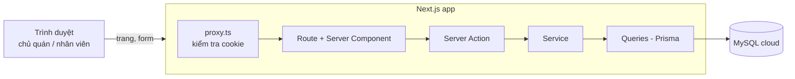
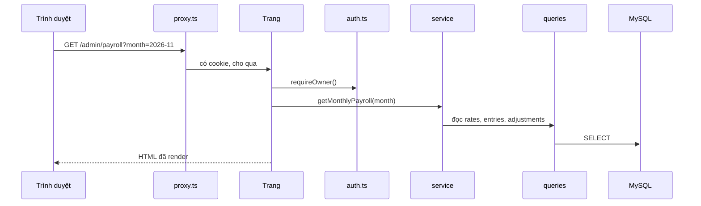
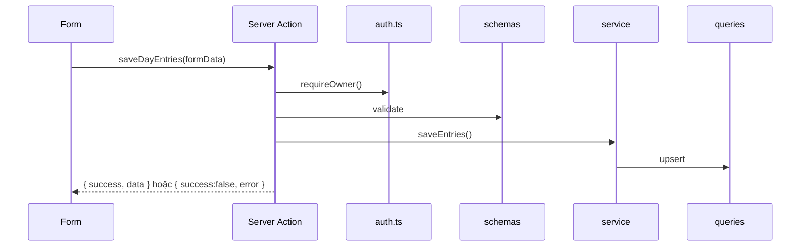
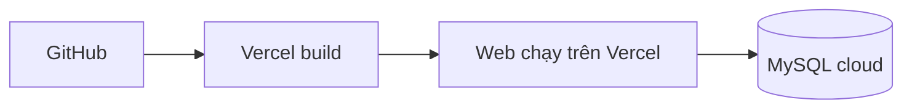

# ARCHITECTURE: Web tính lương Fight Station

Kiến trúc của dự án. Một ứng dụng Next.js 16 duy nhất, tổ chức theo feature. Đọc kèm `SPEC.md`, `DATABASE..md`, `PROJECT-RULES.md`, `API_SPEC.md`.

## 1. Tổng quan



**Vì sao một app Next.js:** quán nhỏ, vài chục nhân viên, một người quản lý. Một app dễ làm, dễ triển khai lên Vercel, không cần dựng API riêng. Server Component đọc dữ liệu, Server Action ghi dữ liệu.

**Vì sao tổ chức theo feature:** mỗi nghiệp vụ (nhân viên, mức lương, chấm công, thưởng phạt, bảng lương) nằm gọn trong một thư mục, dễ làm từng bước và dễ tìm.

## 2. Cấu trúc thư mục

```
prisma/
├── schema.prisma          # 5 bảng, xem DATABASE..md
└── seed.ts                # ca mặc định + tài khoản chủ quán
proxy.ts                   # chặn trang khi chưa có cookie session
src/
├── app/                   # chỉ route và layout, mỏng
│   ├── layout.tsx
│   ├── page.tsx           # chuyển hướng theo vai trò
│   ├── login/
│   ├── change-password/
│   ├── admin/             # chủ quán: staff, rates, attendance, adjustments, payroll, shifts, stats
│   └── me/                # nhân viên: lương của tôi
├── features/              # nghiệp vụ, xem mục 3
│   ├── auth/
│   ├── staff/
│   ├── shifts/
│   ├── rates/
│   ├── attendance/
│   ├── adjustments/
│   ├── payroll/
│   ├── stats/
│   └── me/
├── lib/                   # hạ tầng dùng chung
│   ├── prisma.ts          # PrismaClient duy nhất
│   ├── session.ts         # ký, đọc, xóa cookie
│   ├── auth.ts            # getCurrentUser, requireUser, requireOwner
│   └── result.ts          # ok(), fail(), kiểu ActionResult
└── shared/                # UI và tiện ích không có nghiệp vụ
    ├── components/        # Header, Button, MonthPicker, EmptyState
    └── utils/             # format tiền, ngày, tháng
```

Tạo thư mục khi dùng đến, không tạo trước cho đủ.

## 3. Giải phẫu một feature

```
features/<feature>/
├── actions.ts     # "use server": kiểm quyền, validate, gọi service
├── service.ts     # business logic
├── queries.ts     # chỉ gọi Prisma
├── schemas.ts     # zod
├── types.ts
├── utils.ts       # hàm thuần
├── components/    # UI của feature
├── tests/
├── index.ts       # export công khai
└── context.md
```

Ví dụ `payroll`: `utils.ts` chứa `calculatePay` (hàm thuần), `service.ts` ghép dữ liệu từ `rates`, `attendance`, `adjustments` rồi gọi `calculatePay`.

## 4. Luồng request

**Đọc dữ liệu:**



**Ghi dữ liệu:**



Phân vai:
- **Trang / Server Component:** kiểm quyền, đọc dữ liệu, render.
- **Server Action:** kiểm quyền, validate, định dạng kết quả.
- **Service:** business logic (tính lương, chép mức tháng, chặn Off trùng).
- **Queries:** chỉ truy cập Prisma.

## 5. Xác thực và phân quyền

```mermaid
flowchart TD
  L[POST login] --> V{đúng mật khẩu<br/>và is_active?}
  V -- không --> E[trả lỗi AUTH_001]
  V -- có --> C[set cookie session<br/>JWT 7 ngày, httpOnly]
  C --> R{role}
  R -- OWNER --> A[/admin]
  R -- STAFF --> M[/me]
```

- Hai lớp kiểm tra. `proxy.ts` chỉ kiểm tra có cookie hay chưa, nhanh. Quyền thật nằm ở `requireUser()` và `requireOwner()` trong từng trang và Server Action, có tra DB để chặn tài khoản đã khóa.
- Nhân viên chỉ đọc được lương của chính mình. Hàm đọc lương của feature `me` luôn lấy `userId` từ session, không từ tham số.

## 6. Giao tiếp giữa các feature

| Cách | Khi dùng |
| --- | --- |
| Gọi hàm export qua `index.ts` | `payroll` đọc dữ liệu từ `rates`, `attendance`, `adjustments` |
| Truyền tham số qua URL | tháng đang xem: `?month=2026-11` |
| `lib/` dùng chung | phiên đăng nhập, Prisma, kiểu kết quả |

Bị cấm: import vào file nội bộ của feature khác, phụ thuộc vòng, state toàn cục.

## 7. Lib và Shared

| `lib/` | `shared/` |
| --- | --- |
| Prisma client, phiên đăng nhập, kiểm quyền | Component UI dùng lại |
| Kiểu kết quả `ActionResult` | Hàm format tiền, ngày, tháng |
| Chỉ chạy ở server (`server-only`) | Dùng được ở cả server và client |

## 8. Quản lý dữ liệu và trạng thái

| Loại | Chỗ lưu | Ví dụ |
| --- | --- | --- |
| Dữ liệu nghiệp vụ | MySQL, đọc ở Server Component | bảng lương, chấm công |
| Phiên đăng nhập | cookie httpOnly | user, vai trò |
| Tháng, ngày đang xem | URL (`searchParams`) | `?month=2026-11` |
| Trạng thái form | `useActionState` | lỗi, đang gửi |
| UI cục bộ | `useState` trong component | mở hộp thoại |

Sau khi ghi, gọi `revalidatePath` cho trang liên quan để dữ liệu mới hiện ngay.

## 9. Routing

| Route | Vai trò | Nội dung |
| --- | --- | --- |
| `/login` | công khai | đăng nhập |
| `/admin` | OWNER | trang chủ quản lý |
| `/admin/staff` | OWNER | nhân viên |
| `/admin/rates` | OWNER | mức lương theo tháng |
| `/admin/attendance` | OWNER | chấm công theo ngày |
| `/admin/adjustments` | OWNER | thưởng phạt |
| `/admin/stats` | OWNER | thống kê ngày nghỉ, lỗi, phạt |
| `/admin/payroll` | OWNER | bảng lương tháng |
| `/admin/shifts` | OWNER | cài đặt ca |
| `/me` | OWNER, STAFF | lương của tôi |
| `/change-password` | OWNER, STAFF | đổi mật khẩu |
| `/manifest.webmanifest` | công khai | web app manifest (PWA) |
| `/apple-icon.png` | công khai | icon iPhone Home Screen |
| `/icon-*.png` | công khai | icon Android Home Screen |

`proxy.ts` chặn `/admin/*`, `/me/*` và `/change-password` khi chưa có cookie. File tĩnh (`manifest.webmanifest`, icon) luôn truy cập được, không cần đăng nhập.

## 10. PWA (Progressive Web App)

App hỗ trợ cài đặt trên màn hình chính:
- **Manifest:** `src/app/manifest.ts` tạo `/manifest.webmanifest` tự động, chứa tên, mô tả, icon, màu nền và chủ đạo.
- **Icon:** Bốn file PNG trong `public/`:
  - `icon-192x192.png`, `icon-512x512.png`: dành cho Android (purpose: "any" và "maskable").
  - `apple-icon.png`: dành cho iPhone (qua `appleWebApp.capable`).
- **Metadata:** `src/app/layout.tsx` xuất `Metadata` và `Viewport`, bao gồm `themeColor`, `appleWebApp` (tên, statusBarStyle).
- **Không có Service Worker:** App chưa xem được offline vì tránh cache dữ liệu lương nhạy cảm. Nếu cần offline đầy đủ, dùng Serwist nhưng chỉ cache file tĩnh.

**Kiểm tra:** Chạy `npm run build && npm start`, vào DevTools > Application > Manifest xem manifest và icon.

## 10. Cấu hình và bí mật

| Biến | Dùng để |
| --- | --- |
| `DATABASE_URL` | kết nối MySQL |
| `SESSION_SECRET` | ký JWT, tối thiểu 32 ký tự |
| `OWNER_USERNAME`, `OWNER_PASSWORD` | tạo tài khoản chủ quán lần đầu khi chạy seed |

- Không đưa `.env` lên Git, chỉ có `.env.example`.
- Trên Vercel đặt biến trong phần Environment Variables.
- `next.config.ts` không bật `cacheComponents`.

## 11. Triển khai



Thứ tự: tạo MySQL cloud, đặt biến môi trường trên Vercel, chạy `prisma db push` và `npm run db:seed` một lần, rồi mới đưa code lên.
